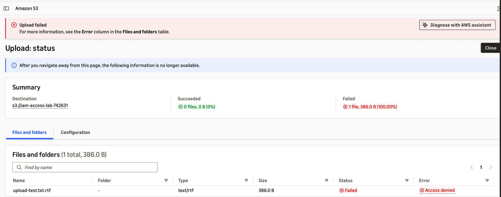
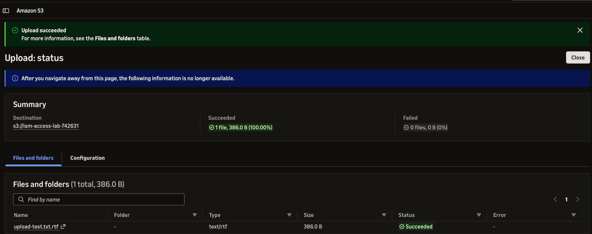

# AWS S3 Role-Based Access Lab

I configured two AWS IAM roles to control access to a private S3 bucket.
Both roles could list and download files. The Contributor role could also
upload files. Neither role could delete files.

## What I configured

- A private S3 bucket with Block Public Access enabled.
- A Reader role with `s3:ListBucket` and `s3:GetObject`.
- A Contributor role with the same permissions plus `s3:PutObject`.
- A trust policy on each role that allowed a dedicated lab user to assume it.

## Live test results

| Test | Reader | Contributor |
|---|---|---|
| Download `sample.txt` | Allowed | Allowed |
| Upload the same test file | Denied | Allowed |
| Delete the uploaded test file | Denied | Denied |

## What I learned

I tested the same upload against the same bucket under both roles.
S3 denied the request as Reader and accepted it as Contributor.
I also verified that the Contributor could not delete the file it had
just uploaded. This showed that upload and delete permissions can be
controlled independently.

## Test evidence

### Reader upload denied

### Contributor upload allowed

